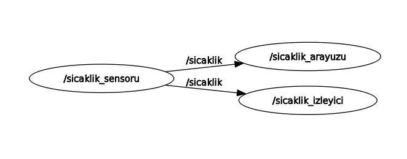

# ROS 2 Humble - Sıcaklık İzleyici

Ubuntu 22.04 ve ROS 2 Humble kullanılarak Python ile geliştirilmiş sanal sıcaklık izleme uygulamasıdır.

## Proje Özellikleri

- Her saniye 20–40 °C arasında rastgele sıcaklık üretimi
- `/sicaklik` konusu üzerinden `std_msgs/msg/Float32` mesaj yayını
- Sıcaklık değerlerinin terminalde izlenmesi
- 30 °C üzerindeki sıcaklıklarda uyarı verilmesi
- ROS 2 parametresiyle ayarlanabilir sıcaklık eşiği
- PyQt5 masaüstü arayüzü
- Gerçek zamanlı sıcaklık grafiği
- Minimum, maksimum ve ortalama sıcaklık değerleri
- CSV dosyasına veri kaydetme
- ROS 2 Launch ile tek komutla çalıştırma

## Gereksinimler

- Ubuntu 22.04 LTS
- ROS 2 Humble
- Python 3
- rclpy
- std_msgs
- PyQt5
- PyQtGraph
- colcon
- ros-humble-launch-ros

## Kurulum
```bash
sudo apt update
sudo apt install python3-pyqt5 python3-pyqtgraph \
  python3-colcon-common-extensions \
  ros-humble-rqt-graph
```

## ROS 2 ortamını etkinleştirin:

```bash
source /opt/ros/humble/setup.bash
```

## Çalışma alanını hazırlayın:

```bash
mkdir -p ~/ros2_ws/src
cd ~/ros2_ws/src
git clone https://github.com/EmirhanEn/Ros2_Sicaklik_Izleyici.git sicaklik_izleyici_py
```


## Derleme

```bash
source /opt/ros/humble/setup.bash
cd ~/ros2_ws
colcon build --packages-select sicaklik_izleyici_py
source install/setup.bash
```


## Tek Komutla Çalıştırma

```bash
ros2 launch sicaklik_izleyici_py sicaklik.launch.py
```

Bu komut sıcaklık sensörünü, izleyiciyi ve PyQt5 arayüzünü başlatır.


## Ayrı Ayrı Çalıştırma

### Her terminalde önce:

```bash
source ~/ros2_ws/install/setup.bash
```

### Sensör:

```bash
ros2 run sicaklik_izleyici_py sensor
```

### İzleyici:

```bash
ros2 run sicaklik_izleyici_py izleyici
```

### Arayüz:

```bash
ros2 run sicaklik_izleyici_py arayuz
```
## Sıcaklık Eşiği

Varsayılan uyarı eşiği 30 °C'dir.

İzleyiciyi farklı bir eşikle başlatmak için:

```bash
ros2 run sicaklik_izleyici_py izleyici \
  --ros-args -p esik_degeri:=35.0
```
  
Çalışan izleyicinin eşiği PyQt5 arayüzünden de değiştirilebilir.

## ROS 2 Düğüm Grafiği



## Proje Dosyaları

- `sensor.py`: Rastgele sıcaklık üretir ve yayınlar.
- `izleyici.py`: Sıcaklık değerlerini dinler ve uyarı üretir.
- `arayuz.py`: Grafik arayüzünü çalıştırır.
- `launch/sicaklik.launch.py`: Üç düğümü birlikte başlatır.

